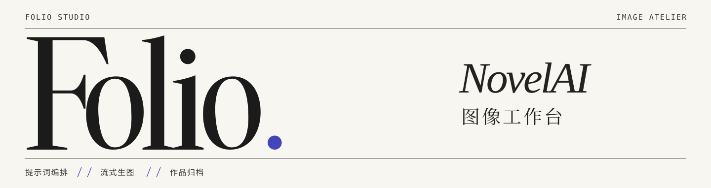
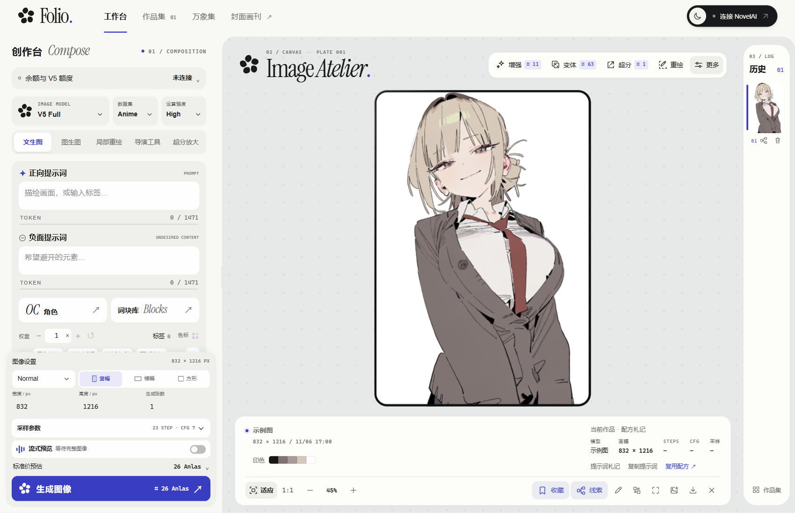

<p align="center">
  
</p>

**Folio 是一座在本机运行的 NovelAI 插画工作台。** 左手写提示词，中间看画面逐步成形，右手翻看刚刚生成的版本。走进作品集，还能沿着一张图找回它的配方、角色，以及后来做过的每一次修改。

[快速开始](#快速开始)　／　[创作与归档](#创作与归档)　／　[本地数据](#本地数据)　／　[许可](#许可)



<sub>工作台实景 · 示例插画由项目维护者提供。　<a href="public/art/portrait-study.png">查看原图 ↗</a></sub>

## 快速开始

**Windows x64**　下载便携包，完整解压后双击 **启动工作台.cmd**。包内已附 Node.js 运行时。[下载 Folio 1.0.0](https://github.com/salmantais961-boop/NAI-Folio/releases/download/v1.0.0/NAI-Folio-1.0.0-windows-x64.zip) · [版本与校验文件](https://github.com/salmantais961-boop/NAI-Folio/releases/tag/v1.0.0)

### 从源码运行

准备 **Node.js 22.2 或更高版本**。前端、字体与运行所需的库已随仓库提供，克隆后即可启动。

```sh
git clone https://github.com/salmantais961-boop/NAI-Folio.git
cd NAI-Folio
npm start
```

打开 [本地工作台](http://127.0.0.1:4389/)。Windows 用户也可以双击根目录的 **启动工作台.cmd**。

1. 点右上角 **连接 NovelAI**，填入自己的 API Key。可以仅在本次使用，也可以在当前浏览器保存多个账号。使用中转站时，选择 **NAI API 中转站** 并填入兼容 NovelAI 原生协议的地址。
2. 在正向提示词里试试 `portrait, short hair, cardigan, white background`，选择模型和画幅。生成按钮会显示本次预计消耗，余额与 V5 配额取决于所连服务提供的信息。
3. 开启 **流式预览**，按 <kbd>Ctrl</kbd> + <kbd>Enter</kbd> 生成。支持流式的模型会逐步回传画面，最终图像自动进入历史和作品集。

## 创作与归档

| | 在 Folio 里可以做什么 |
| --- | --- |
| **工作台** · *Atelier* | 用中英文搜索标签，以颜色读出权重。把常用提示词收成词块，在句子中拖动、展开或合并。OC 和图鉴角色进入独立角色栏，正负提示词分别计算 token。 |
| **画布** · *Canvas* | 从草稿做图生图、重绘和扩图，也可以在成图上直接超分、打开导演工具。按模型使用参考图、Vibe 或角色位置。 |
| **作品集** · *Archive* | 按原图比例浏览瀑布流。按提示词模糊搜索，给喜欢的图评分，在鉴赏页查看 META，勾选要带到下一张图的参数。 |
| **万象集** · *Atlas* | 从作品集收藏或从本机导入，把素材、OC 和词块例图分门别类。下次需要同一角色或画风时，可以直接引用。 |

想看一张图是怎么改出来的？在成图上打开 **线索**。超分和重绘保留来源，轻微改词或沿用角色的作品也能在画布上找到关联。相同提示词的图片放在同一组，可以拖动整理。

## 本地数据

- **作品与账号**　作品、评分和万象集保存在当前浏览器的 IndexedDB。选择保存的 API Key 存在该浏览器的本地存储中。切换端口、浏览器或浏览器配置会进入另一份工作空间，清理站点数据前请导出重要作品。
- **请求与费用**　工作台只监听 `127.0.0.1`。生成时，提示词和选中的参考素材会发往所选 NovelAI 服务或中转站。Anlas 与配额在提交前显示估算，实际扣费以所连服务为准。
- **词库与分词**　公开版附带小型离线示例图鉴。可将有权使用的完整索引导入本机，提示词计数也在本地完成。[图鉴导入指南](docs/catalog.md) · [分词数据来源](public/tokenizers/README.md)

<details>
<summary><strong>开发与运行</strong></summary>

页面使用原生 ES 模块，本地代理使用 Node.js 内置 HTTP 服务。`public/` 是前端，`server/` 负责 NovelAI 协议，`test/` 包含接口与创作流程用例。

```sh
npm run dev
npm test
```

`PORT` 可以修改监听端口。也可在启动进程的环境中设置 `NOVELAI_TOKEN` 供官方连接使用。中转站使用各自的账号配置。

</details>

## 许可

Folio 自有代码采用 MIT。字体、分词数据、第三方组件和展示插画的授权分别列出。Folio 是独立社区工具，图像生成由用户所选服务提供。[MIT 许可](LICENSE) · [素材与第三方声明](THIRD_PARTY_NOTICES.md)
