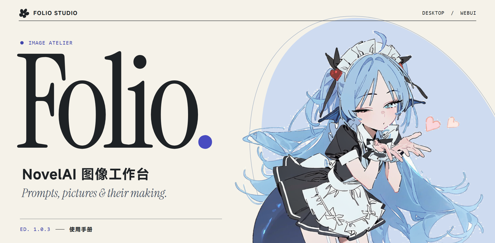
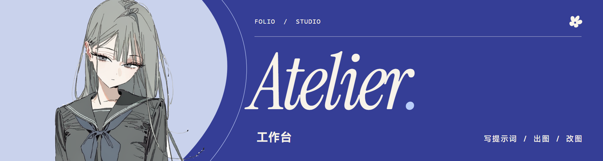
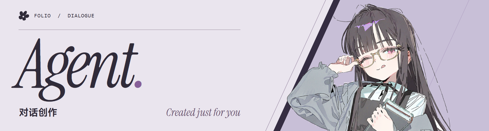
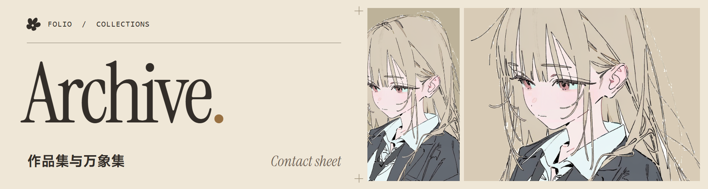

# 

**Folio 是一个在自己电脑上用的 NovelAI 画图工具。** 当你画出一张喜欢的图，想再试试别的光线，可以把角色和种子留下，只改光线。过几天想起这张画，搜当初写过的词，就能把原图和那次用的设置一起翻出来。

[下载和连接](#下载和连接)　/　[画第一张图](#画第一张图)　/　[对话画图](#对话画图)　/　[把图留下来](#把图留下来)　/　[从源码运行](#从源码运行)

## 下载和连接

| Windows x64 | 怎么打开 |
| --- | --- |
| [**桌面安装版 ↓**　EXE](https://github.com/salmantais961-boop/NAI-Folio/releases/download/v1.11.1/Folio-Desktop-1.11.1-windows-x64-setup.exe) | 安装后，从开始菜单打开 **Folio Desktop**。想用 Agent 对话画图，选这个版本。 |
| [**浏览器便携版 ↓**　ZIP](https://github.com/salmantais961-boop/NAI-Folio/releases/download/v1.11.1/NAI-Folio-1.11.1-windows-x64.zip) | 把压缩包完整解压，双击 **启动工作台.cmd**，工作台会在浏览器里打开。 |

两个下载都在 1.11.1 发布页，校验文件也放在那里。[更新说明](https://github.com/salmantais961-boop/NAI-Folio/releases/tag/v1.11.1) · [SHA-256 校验清单](https://github.com/salmantais961-boop/NAI-Folio/releases/download/v1.11.1/SHA256SUMS.txt)

第一次打开桌面版，跟着引导先选 NovelAI 官方账户或中转站，再选 Agent 对话用的语言模型。只想先看看界面，可以跳过，之后到设置里补填。使用 WebUI 时，点右上角 **连接 NovelAI** 即可添加账户。



## 画第一张图

在左边的正向提示词里试试 `portrait, window light, watercolor`，选一个竖画幅，点 **生成图像**。按钮旁会估算这次要花多少 Anlas，支持额度查询的账户还能看到 V5 用量。打开 **流式预览** 后，支持流式的服务会把中间画面一步步送回来。等图的这段时间，可以点右侧历史翻看前几张。


**提示词不用每次从头写。** 记得中文、不记得英文时，输入「柔光」也能找出 `soft lighting`。用上下方向键挑词，按 Tab 插入。常用的一整串画风可以存成词块。下次点一下就能插进提示词，拖动可以换位置，展开还能看里面写了什么。调权重时，每个 tag 的底色会跟着变，输入框下方也能看到当前用了多少 token。

**两个人物可以各写各的。** 在支持多角色的模型里，把场景写进正向提示词，再分别给两个人物写发色和衣服。习惯一行写完，也可以输入 `2girls | girl, red hair | girl, blue hair`，发送时会自动拆成两个角色。点角色图鉴或引用自己的 OC，同样会进独立的角色栏。

**想保留这张图的构图，再换个细节？** 在画布上打开重绘，涂出想改的那一块。想顺着原图多试几个版本，可以生成变体。只想把成图放大，点 **超分** 就能直接做 2× 放大。复用老图时也可以单独勾选提示词、种子、尺寸或采样参数。



## 对话画图

打开桌面版顶栏的 **Agent**，先锁定你常用的画风词块，然后像跟人约稿一样说出画面。

> 画一个抱着书的长发女孩。她一只手扶着细框眼镜，正抬头看我。先给我看看提示词。

展开回复里的配方，就能看到 Agent 写的提示词。用支持多角色的模型时，人物和场景会分开写。想改构图，接着说「镜头近一点，保留手和眼镜，现在出图」。新图会进右侧历史和作品集。下次另开对话，锁定的正向和负面词块也会跟过去。

**有名字的角色也可以直接点名。** Agent 会先查本地图鉴。启用 DeepSeek 联网检索后，它还能核对英文名、别名和 Danbooru 标签，再补需要的服装或外观细节。展开工具记录就能看到它查了什么、找到了什么。写好的提示词会按当前 NAI 模型重新计数，超出预算就先精简。[桌面 Agent 使用指南](docs/desktop-agent.md)



## 把图留下来

**作品集里放着每一张成图。** 按原图比例往下翻，点开一张，左边看大图，右边看提示词、种子和生成参数。可以给它打 0 到 5 分，打开搜索框旁的 **高分优先**，喜欢的几张就会排到前面。要带走一组图，搜一个当初用过的词，选全部命中或自己勾几张，就能统一打标、把原图和标签清单一起下载。

**万象集里放下次还想用的东西。** 从作品集收藏一张图，或者把电脑里的参考图导进来都行。素材可以拿去做图生图。OC 可以记名字和外貌，用时直接加进多角色。例图可以跟一组固定提示词绑在一起，下次挑词块时就知道它大概能画出什么感觉。分类、标签和配图都可以自己改。

**忘了哪张是超分前的原图？** 从成图打开 **线索**。画布上的连线会标出哪张经过放大或重绘，也能找到复用过元数据、角色相同或只改了几个词的版本。把卡片拖开，就能对着看这张画是怎么一路改过来的。

### 换电脑前，记得把作品带走

桌面版和 WebUI 各有一份本地工作区。浏览器换配置、换端口或清理站点数据，都会影响能看到哪一份作品。准备迁移时，可以在作品集打包要留的原图，在工作台用 **配方** 导出要留的生成设置。选择保存的 API Key 留在当前工作区的本地存储里。

点生成时，提示词和选中的参考图会发给你连接的 NovelAI 或中转站，最终扣费以该服务为准。设置里的 **隐藏 NSFW** 根据正向提示词和角色标签在本机筛选，打开后也会避开相关预览和批量导出项。

### 从源码运行

准备 Node.js 22.2 或更新版本，执行下面三行。第一次启动会从小米官方获取并校验 MiSans 字体，以后复用本地文件。

```sh
git clone https://github.com/salmantais961-boop/NAI-Folio.git
cd NAI-Folio
npm start
```

启动后用浏览器打开 [本地工作台](http://127.0.0.1:4389/)。

<details>
<summary><strong>自己改代码、构建桌面版或换图鉴</strong></summary>

网页界面在 `public/`，NovelAI 请求处理在 `server/`。运行 `npm run dev` 可以监听修改，`npm test` 运行测试。WebUI 支持用 `PORT` 指定端口，也可以用环境变量 `NOVELAI_TOKEN` 连接官方服务。

桌面壳使用 Rust 和 Tauri。要在 Windows x64 构建，先装好 Rust MSVC 工具链、Visual Studio C++ 生成工具和 Windows SDK。运行 `npm run desktop:build` 得到 `desktop-build/Folio/Folio.exe`。运行 `npm run desktop:installer` 制作安装包，输出在 `src-tauri/target/release/bundle/nsis/`。

桌面版和 WebUI 都自带 243,910 条标签联想、15,879 位画师和 34,301 个角色。输入「初音未来」就能找到 Hatsune Miku，多角色栏还能带入她的外貌标签。词库检索和提示词计数都在本机完成。[图鉴与导入方法](docs/catalog.md) · [分词数据来源](public/tokenizers/README.md)

</details>

画刊里的四张人物插画由项目维护者提供，透明底素材也一并收录。[蓝发角色](docs/media/edition/cutouts/tide.webp) · [灰发角色](docs/media/edition/cutouts/graphite.webp) · [抱书的眼镜女孩](docs/media/edition/cutouts/agent.webp) · [浅金发角色](docs/media/edition/cutouts/linen.webp)

Folio 是独立的社区项目。代码采用 MIT 许可，插画、字体和第三方组件各有自己的使用条款。[MIT 许可](LICENSE) · [素材与第三方声明](THIRD_PARTY_NOTICES.md)
